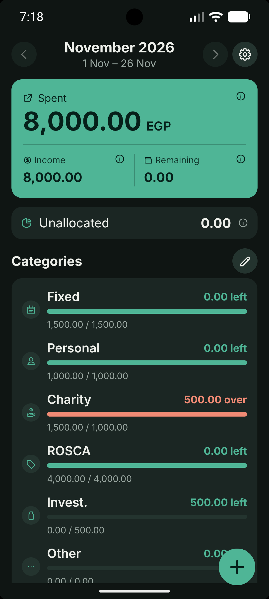
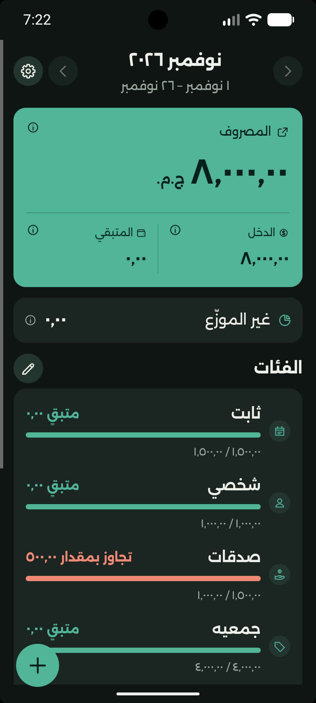

# Hi, I'm Ziad

Junior full stack developer with 1 year of experience, mostly building APIs and services with Node.js, TypeScript and MongoDB. On the DevOps side I set up CI/CD with GitHub Actions and deploy to AWS. I started as an intern and moved into a junior role. Before tech, I worked as a physical therapist.

## Experience

**Junior Full Stack Developer · Battal** (Jan 2026 – Present, Remote)
- Built a shared library of common database models, logging, and email services, replacing duplicated code across 3 backend repositories
- Set up CI/CD with GitHub Actions to automatically deploy to dev and production on every push
- Deployed backend apps to AWS EC2 using PM2

## Projects

**[Mizan — offline-first money tracker](https://github.com/ZiadMohamedAly14/simple-money-tracker)** · Expo · React Native · Node.js · Express · MongoDB · TypeScript

An Android app for monthly budgeting, plus a Kid Wallet where parents teach children about money. Works fully offline and supports English and Arabic (right to left).

- Built an Express and MongoDB API with passwordless email sign-in, rotating hashed refresh tokens and rate limiting
- Designed the sync protocol between devices and the server: client-generated UUIDv7 IDs, a server-version cursor and last-write-wins conflict handling
- Structured it as a TypeScript monorepo with a shared domain package, covered by 1,000+ Jest tests (including tests against a real in-memory MongoDB) and run in GitHub Actions CI
- Planned it spec-first with architecture decision records, and used AI coding agents for implementation

  
  &nbsp;
  

## Tech

**Backend:** Node.js · Express · TypeScript · MongoDB · Mongoose · Jest
**DevOps:** AWS (EC2) · GitHub Actions · PM2 · Git
**Frontend:** React · Next.js · JavaScript

## Contact

I'm open to new opportunities and interviews.

[LinkedIn](https://www.linkedin.com/in/ziad-mhd) · [Email](https://mail.google.com/mail/?view=cm&to=iziadmohamedaly14@gmail.com)
