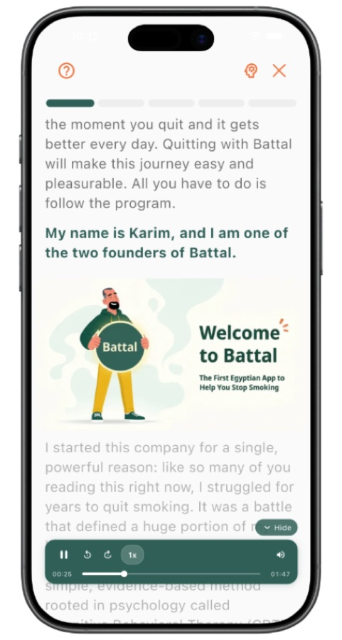

# Hi, I'm Ziad

**Junior Full Stack Developer at [Battal](https://battalapp.com/)** · Backend & DevOps focused · Cairo, Egypt 🇪🇬

I came to software from physical therapy. I started as an intern and moved into a junior role, and most of my first year has been backend work: building APIs and services with Node.js, TypeScript and MongoDB, setting up CI/CD with GitHub Actions and deploying to AWS.

---

## Projects

<table>
<tr>
<td valign="middle">

### [Mizan](https://github.com/ZiadMohamedAly14/simple-money-tracker): Offline-First Money Tracker

An Android app for monthly budgeting, plus a Kid Wallet where parents teach children about money. Works fully offline and supports English and Arabic (right to left).

- Built an Express and MongoDB API with passwordless email sign-in, rotating hashed refresh tokens and rate limiting
- Designed the sync protocol between devices and the server: client-generated UUIDv7 IDs, a server-version cursor and last-write-wins conflict handling
- Structured it as a TypeScript monorepo with a shared domain package, covered by 1,000+ Jest tests and run in GitHub Actions CI
- Planned it spec-first with architecture decision records, and used AI coding agents for implementation

Node.js · Express · MongoDB · TypeScript · Expo · React Native

</td>
<td width="200" align="center" valign="middle">
  
</td>
</tr>
</table>

---

## Experience

<table>
<tr>
<td valign="middle">

### Junior Full Stack Developer · [Battal](https://battalapp.com/)
Jan 2026 – Present · Cairo, Egypt · Remote

Battal is an app that helps people quit smoking.

- Built a shared library of common database models, logging and email services, replacing duplicated code across 3 backend repositories
- Set up CI/CD with GitHub Actions to automatically deploy to dev and production on every push
- Deployed backend apps to AWS EC2 using PM2

</td>
<td width="200" align="center" valign="middle">
  
</td>
</tr>
</table>

---

## Stack

---

## Education

**Badr University in Cairo (BUC)** · Bachelor of Physical Therapy · 2020 – 2026

## Certificates

- [Fundamentals of Backend Engineering](https://www.udemy.com/certificate/UC-172b72d2-fbae-4595-acb2-8941f3c7d5ad/) · Udemy, Hussein Nasser · Nov 2026

---

## Connect

I'm open to new opportunities and interviews.

[LinkedIn](https://www.linkedin.com/in/ziad-mhd) · [Email](https://mail.google.com/mail/?view=cm&to=iziadmohamedaly14@gmail.com)
